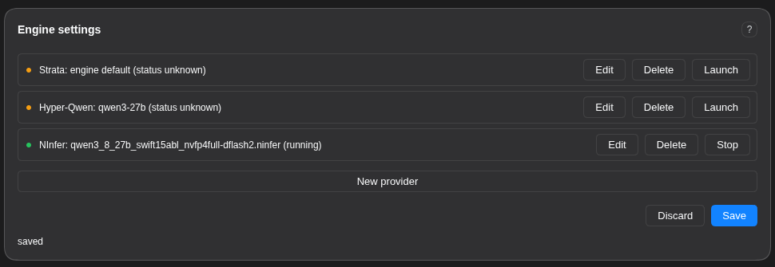

# dsh-plugin-local-infer

[中文 (Chinese)](docs/zh/README.md)

> For those who want more performance out of their specific hardware than what Unsloth gives out of the box.

[](https://github.com/cybtachyon/dsh-plugin-local-infer/blob/main/LICENSE)
[](https://www.npmjs.com/package/@deepseek-ai/dsh)
[](https://github.com/topics/dsh-plugin)

A DeepSeek Harness plugin that manages local inference engines:

- llama.cpp
- NInfer
- Hyper-Qwen (vLLM)
- Strata
- ...with more coming soon.



Pick a model and an engine, tune the parameters, watch a live **VRAM Est.** meter, see **hardware warnings** the moment a value (or a parameter itself) is unsafe for the detected hardware, then the plugin manages **build, deploy, and health-check** for each engine and **automatically register it as a DSH model** once it is confirmed working. No hand-editing of finicky yaml or launchers.

## Install

Command line:

```bash
dsh plugin --profile web add https://github.com/cybtachyon/dsh-plugin-local-infer
```

Web UI: click **Plugins** → **Add Plugin** → paste `https://github.com/cybtachyon/dsh-plugin-local-infer`.

## Using the plugin

The **Engine settings** card mounts on the Plugins page (older hosts: the Settings page).

- **Pick an engine and model**, then tune the parameters. Each field renders by its type: checkboxes, dropdowns, sliders, text, directory pickers, and a chat-template combo (known templates plus free text).
- **Watch the VRAM Est. meter.** It prices weights, KV cache, overhead, and workspace against your card as you adjust values, and shows the verdict (`fits` / `tight` / `over`) and the largest context that fits.
- **Read the warnings.** Red banners and inline field warnings fire when a parameter value, or the presence of a parameter, is unsafe for your detected hardware.
- **Satisfy the system dependencies.** The panel lists each missing host dependency (docker, CUDA toolkit, ffmpeg, hf CLI, ...) with its purpose, a copy/paste install string for your OS, and an optional one-click **Run** (sudo). The **Get** button stays disabled until every dependency reports satisfied.
- **Launch / Stop.** `Launch` clones or pulls the engine, downloads the model, starts it, and polls its health endpoint. `Stop` shuts it down.
- **Register / Remove.** `Register` publishes the confirmed-working engine to DSH as a model (optionally as the agent default model) through the settings service, so the change is revision-tracked and undoable. `Remove` pulls the entry back.

All values persist to `~/.dsh/local-infer/config.json`; the browser never sees a value it did not store.

## Supported Platforms

### Operating systems

| OS                           | State     | Notes                                                                                                               |
|------------------------------|-----------|---------------------------------------------------------------------------------------------------------------------|
| Linux (Debian/Ubuntu, `apt`) | Supported | Install blocks mirror the working NInfer launcher: the CUDA keyring sequence plus the compile toolchain.            |
| Linux (Arch, `pacman`)       | Supported | `pacman` blocks plus the `/opt/cuda` export lines.                                                                  |
| Linux (Fedora, `dnf`)        | Untested  | Command set present, flagged untested on a live host.                                                               |
| macOS (`brew`)               | Partial   | CPU/docker path (llama.cpp). No NVIDIA Container Toolkit on macOS, so the CUDA engines' docker path is unavailable. |
| Windows (WSL2)               | Untested  | WSL2 is detected and the dflash2 pin-memory rule fires; the command set is flagged untested.                        |
| Windows                      | Partial   | Code paths are only partially written; further development needed.                                                  |  

### Engines

| Engine            | Docker        | Local build        | State                                                                        |
|-------------------|---------------|--------------------|------------------------------------------------------------------------------|
| NInfer            | Yes           | Yes (cmake + CUDA) | The reference engine. Measured VRAM models for the Qwen 27B/35B artifacts.   |
| Hyper-Qwen (vLLM) | Yes (compose) | No                 | `.env`-driven docker-compose profiles.                                       |
| vLLM              | No            | No                 | Work-in-progress.                                                            |
| llama.cpp         | Yes           | Yes                | Specified, not verified until the binary is available.                       |
| Strata            | Yes           | No                 | Placeholder engine; its parameter surface is empty until the flag set lands. |

Runtime requirements: Node `^22.19.0 || >=24.0.0`, pnpm 12.11.2 (pinned by `mise.toml`), and the `@deepseek-ai/cordis >= 4.0.1` peer dependency.

## Hardware guide

What each common machine gets you in practice. Capability impressions are sourced from [r/LocalLLaMA](https://www.reddit.com/r/LocalLLaMA/) user threads. "Shared" means unified memory (the model and the OS share the pool).

| Hardware                        | Memory          | What you get                                                                                                                                                                  |
| ------------------------------- | --------------- | ----------------------------------------------------------------------------------------------------------------------------------------------------------------------------- |
| NVIDIA RTX 5090                 | 32 GB VRAM      | Reliably fits model weights up to 23 GB with 240k+ context and vision. Handles complex coding and vision tasks, but needs special tooling for very long or complex tasks.     |
| NVIDIA RTX 4090                 | 24 GB VRAM      | The community workhorse. 30B-class models fit at Q4 and drive coding agents; 70B needs slow CPU offload. Best speed-per-dollar single card.                                   |
| NVIDIA RTX 3090                 | 24 GB VRAM      | The used-card value king. Same 24 GB as a 4090 but an older generation: 32B at Q4 with modest context, no FP8. A single card is limiting; the common advice is to pair two.   |
| NVIDIA RTX PRO 6000             | 96 GB VRAM      | Near-frontier dense models (70B–80B) fit fully in memory with long context, and 32B models can even be fine-tuned (LoRA, full FT). The prosumer ceiling.                      |
| NVIDIA RTX PRO 5500             | 84 GB VRAM      | The rack-oriented 84 GB tier: 70B-class models with headroom, close to the PRO 6000 at a lower price point.                                                                   |
| NVIDIA Tesla V100               | 32 GB VRAM      | Cheap used HBM2 server card. 30B-class at Q4/Q8 at respectable speed (bandwidth is what matters for inference); no FP8, power-hungry. A budget homelab pick.                  |
| NVIDIA Tesla V100               | 16 GB VRAM      | The budget entry. 13B–14B at Q8, or 30B with offload. NVLink pairs double the capacity. Slow by modern standards, surprisingly solid for inference.                           |
| NVIDIA RTX 5090 Laptop          | 24 GB VRAM      | The mobile 4090. 32B at Q4 just fits; realistically ~17B at Q4 once you subtract context.                                                                                     |
| NVIDIA RTX 4090 Laptop          | 16 GB VRAM      | The GPU is overkill for LLMs and the VRAM is underkill: 8B–14B at Q4/Q5 with small context.                                                                                   |
| NVIDIA GB10 (DGX Spark)         | 128 GB shared   | The desktop AI dev box. A 35B MoE runs at ~100 tok/s; 120B+ MoE fits but is slow. Capacity over speed.                                                                        |
| NVIDIA GB10 (DGX Spark)         | 64 GB shared    | Half the pool: 32B–35B MoE with context; 70B is tight.                                                                                                                        |
| NVIDIA RTX N1X                  | 128 GB shared   | The next-generation GB10-class laptop: DGX Spark-class capacity in a laptop. Very new, little real-world data.                                                                |
| NVIDIA RTX N1X                  | 64 GB shared    | The 64 GB tier: 32B-class with context.                                                                                                                                       |
| Apple M4 Ultra                  | 256 GB shared   | The capacity king. 200B+ MoE and 70B at 128K context fit; expect ~5 tok/s on 70B. Slow per token, unmatched capacity.                                                         |
| Apple M4 Ultra                  | 128 GB shared   | 70B–120B-class fits with room; ~5 tok/s. Great for capacity, slow for speed.                                                                                                  |
| AMD Radeon AI PRO R9700         | 32 GB VRAM      | AMD's 32 GB Vulkan card. 32B at Q8 around $1,300, good value; the `radv` driver is not a conformant Vulkan implementation.                                                    |
| AMD Ryzen AI Max+ PRO 495       | 160 GB shared   | The UMA monster. 120B+ MoE fits and coding agents run well (Qwen3-Coder-class models are tuned for UMA); $7k+ systems, slower than a discrete GPU.                            |
| 2x NVIDIA RTX 3090              | 48 GB VRAM      | The community's "minimum for a usable local LLM": 70B at Q4/Q5.                                                                                                               |
| 2x NVIDIA RTX 4090              | 48 GB VRAM      | 70B at Q4 with context; exllama2 quantizations run fast.                                                                                                                      |
| 2x NVIDIA RTX 5090              | 64 GB VRAM      | 120B MoE (GPT-OSS-120B) with 128k context at ~10 tok/s with offload.                                                                                                          |
| 2x NVIDIA Tesla V100 (NVLink)   | 64 GB VRAM      | The budget 64 GB: 70B at lower quant with NVLink bandwidth; older arch, no FP8.                                                                                               |
